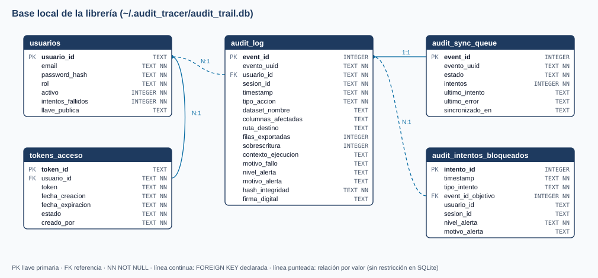
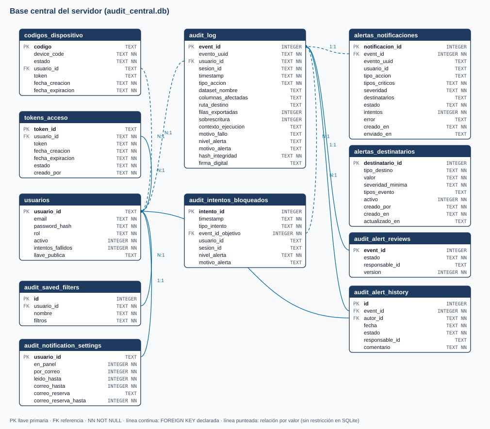
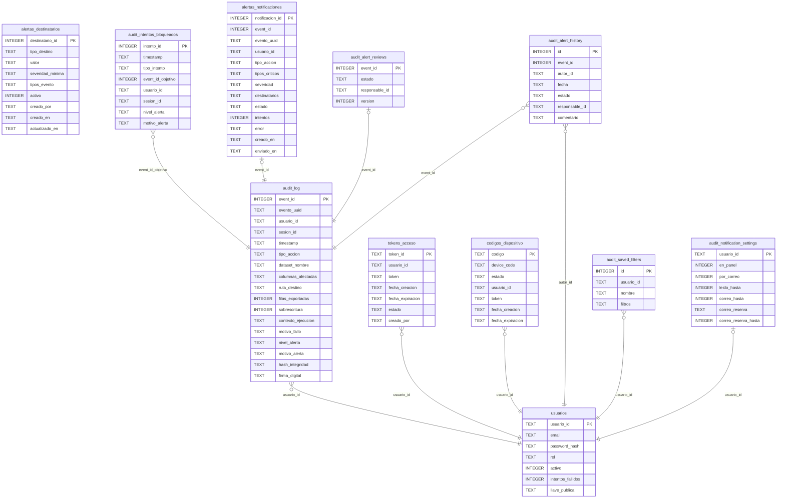
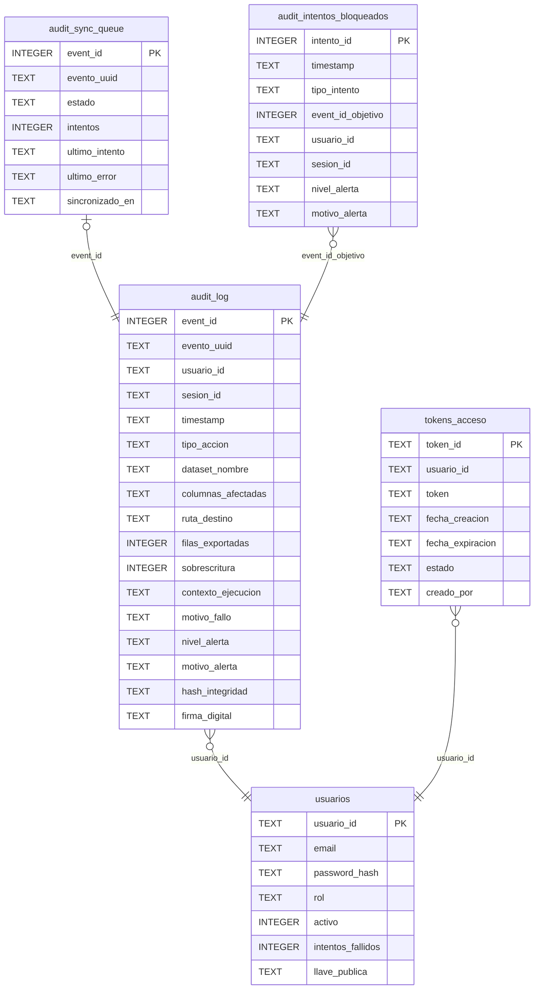

[TOC]

# 1. Alcance y fuentes

El sistema usa **dos bases SQLite con el mismo modelo de evento**:

* **Base local** de la librería, en el equipo del científico de datos (`~/.audit_tracer/audit_trail.db`, o la carpeta de Google Drive en Colab). Guarda cada evento antes de cualquier envío y la cola de sincronización.
* **Base central** del servidor (`audit_central.db` junto a `app.py`). Consolida los eventos de todos los usuarios y guarda cuentas, tokens, códigos de dispositivo, alertas y el espacio de auditoría.

Motor: SQLite en modo **WAL** (`PRAGMA journal_mode = WAL`, verificado: ambas bases reportan `wal`/`wal`), con `busy_timeout = 5000` ms (`audit_tracer/db.py`).

**De dónde sale este documento.** El DDL y las columnas no se copiaron de los archivos `.sql`: `entregables/fuentes/extraer_esquema.py` crea las dos bases desde cero con el mismo código del sistema (incluidas las tablas que se crean en el primer uso) y lee `sqlite_master` y los `PRAGMA`. Los ejemplos son filas reales de la validación con MIMIC-III del 21/11/2026, con los secretos enmascarados. Código: commit `31361a3`.

| Tabla | Local | Central | Propósito | Se crea en |
|---|---|---|---|---|
| `audit_intentos_bloqueados` | Sí | Sí | Constancia de los UPDATE/DELETE bloqueados por los disparadores. | `schema/*.sql; db._IMMUTABILITY_DDL` |
| `audit_log` | Sí | Sí | Bitácora de auditoría: un registro inmutable por evento. | `schema/audit_log.sql (local) y schema/audit_log_central.sql (central)` |
| `audit_sync_queue` | Sí | — | Cola de sincronización de la librería (solo base local). | `schema/audit_log.sql; db._migrate_sync_queue` |
| `tokens_acceso` | Sí | Sí | Tokens personales de la librería y del dashboard. | `schema/tokens.sql` |
| `usuarios` | Sí | Sí | Cuentas, roles y llave pública de firma. | `schema/usuarios.sql` |
| `alertas_destinatarios` | — | Sí | Quién recibe las alertas por correo. | `models/alertas.py (al arrancar el despachador)` |
| `alertas_notificaciones` | — | Sí | Resultado de cada notificación de evento crítico. | `models/alertas.py` |
| `audit_alert_history` | — | Sí | Historial de cambios de estado de las alertas. | `schema/audit_workspace.sql` |
| `audit_alert_reviews` | — | Sí | Estado de revisión de cada alerta (espacio de auditoría). | `schema/audit_workspace.sql (primer uso de /auditoria)` |
| `audit_notification_settings` | — | Sí | Preferencias de aviso por usuario. | `schema/audit_workspace.sql` |
| `audit_saved_filters` | — | Sí | Filtros guardados por usuario en el espacio de auditoría. | `schema/audit_workspace.sql` |
| `codigos_dispositivo` | — | Sí | Login por código de dispositivo (RFC 8628). | `models/device_codes.py (primer uso del login por dispositivo)` |

**Llaves foráneas.** Las FOREIGN KEY declaradas solo se hacen cumplir donde se activa `PRAGMA foreign_keys = ON` (las tablas del espacio de auditoría, `audit_workspace.py:40`). `audit_log.usuario_id` no tiene llave foránea: un evento puede pertenecer a `DESCONOCIDO` o a un usuario de otra base. `tipo_accion` y `nivel_alerta` son texto libre (sin `CHECK`): los valores válidos los impone el código.

**Inmutabilidad.** Los disparadores `trg_audit_log_no_update` y `trg_audit_log_no_delete` existen en las dos bases. Antes de abortar con `RAISE(FAIL)` insertan una fila en `audit_intentos_bloqueados`. `RAISE(FAIL)` aborta la sentencia pero conserva lo que el disparador ya escribió, así que la constancia queda guardada; la excepción es que quien ejecuta la sentencia la envuelva en una transacción explícita y la revierta (`BEGIN … ROLLBACK`): en ese caso no queda constancia (verificado el 21/11/2026 contra una base central creada con `get_central_connection`).

# 2. Diagramas entidad-relación





Fuente Mermaid de la base central (equivalente, para editarla o versionarla):



Fuente Mermaid de la base local:



# 3. DDL completo (SQLite)

Sentencias tal como quedan en `sqlite_master` (incluidos los comentarios del código fuente), seguidas de los índices y disparadores de cada tabla.

## 3.1 Base local (librería)

**audit_intentos_bloqueados**

```sql
CREATE TABLE audit_intentos_bloqueados (
    intento_id        INTEGER  PRIMARY KEY AUTOINCREMENT,
    timestamp         TEXT     NOT NULL DEFAULT (strftime('%Y-%m-%dT%H:%M:%f', 'now')),
    tipo_intento      TEXT     NOT NULL,   -- 'INTENTO_MODIFICACION' | 'INTENTO_ELIMINACION'
    event_id_objetivo INTEGER  NOT NULL,
    usuario_id        TEXT,
    sesion_id         TEXT,
    nivel_alerta      TEXT     NOT NULL DEFAULT 'CRITICO',
    motivo_alerta     TEXT
);
```

**audit_log**

```sql
CREATE TABLE audit_log (

    -- IDENTIFICADOR ÚNICO DEL EVENTO (en esta base)
    event_id          INTEGER  PRIMARY KEY AUTOINCREMENT,
    -- Clave primaria autogenerada. Nunca puede repetirse ni ser nula.
    -- Única solo dentro de ESTA base; para deduplicar entre esta base
    -- local y la central (HU-5.4) se usa evento_uuid, no este campo.

    -- IDENTIFICADOR ÚNICO GLOBAL DEL EVENTO (HU-5.4 CA1)
    evento_uuid       TEXT     UNIQUE NOT NULL,
    -- UUID4 generado en Python al construir el evento (ver
    -- audit_tracer/models/audit_log.py::_prepare_event()). No participa
    -- del cálculo de hash_integridad. Permite que la futura sincronización
    -- HU-5.8 reintente sin duplicar eventos en la base central.

    -- IDENTIFICACIÓN DEL ACTOR
    usuario_id        TEXT     NOT NULL,
    -- ID único del usuario que ejecutó la acción.
    -- Si no es identificable: 'DESCONOCIDO'
    -- Exigido por HIPAA §164.312(b)

    sesion_id         TEXT     NOT NULL,
    -- UUID único por sesión de trabajo.
    -- Vincula todos los eventos de una misma ejecución.

    -- TEMPORALIDAD
    timestamp         TEXT     NOT NULL,
    -- Fecha y hora en formato ISO 8601: 'YYYY-MM-DDTHH:MM:SS.ffffff'
    -- Ejemplo: '2026-04-14T10:32:15.123456'
    -- Exigido por HIPAA §164.312(b)

    -- TIPO DE EVENTO
    tipo_accion       TEXT     NOT NULL,
    -- Valores permitidos:
    -- CARGA              → pd.read_csv(), pd.read_excel()
    -- CONSULTA           → df[], df.query()
    -- TRANSFORMACION     → dropna(), fillna(), drop(), rename(), apply(), merge()
    -- EXPORTACION        → to_csv(), to_excel(), to_json(), to_parquet()
    -- MODELADO           → model.fit()
    -- MODELADO_FALLIDO   → error durante entrenamiento
    -- ACCESO_FALLIDO     → PermissionError, FileNotFoundError
    -- INICIO_SESION      → import audit_tracer
    -- CIERRE_SESION      → fin normal de script/kernel
    -- SESION_INTERRUMPIDA → cierre abrupto del kernel
    -- CAMBIO_ROL         → asignación/modificación de rol
    -- CREACION_USUARIO   → registro de nuevo usuario
    -- ACCESO_DENEGADO    → intento sin permisos

    -- CONTEXTO DEL DATO AFECTADO
    dataset_nombre    TEXT,
    -- Nombre del archivo o dataset sobre el que se operó.
    -- Ejemplo: 'PATIENTS.csv', 'admissions_clean.csv'

    columnas_afectadas TEXT,
    -- Lista de columnas involucradas (JSON array o string separado por comas).
    -- Ejemplo: '["subject_id", "diagnosis", "age"]'

    ruta_destino      TEXT,
    -- Ruta del archivo de destino en operaciones de exportación.
    -- Ejemplo: '/outputs/resultados_modelo.csv'

    filas_exportadas  INTEGER,
    -- Número de filas incluidas en una exportación (tipo_accion = EXPORTACION).
    -- Exigido por HU-2.3 CA2.

    sobrescritura     INTEGER,
    -- Indicador de sobrescritura de archivo en exportaciones (0/1).
    -- 1 = el archivo de destino ya existía y fue sobreescrito.
    -- Exigido por HU-2.3 CA3.

    -- CONTEXTO DE EJECUCIÓN
    contexto_ejecucion TEXT,
    -- Nombre del script o notebook desde el cual se ejecutó la operación.
    -- Ejemplo: 'analisis_readmision.ipynb', 'preprocesamiento.py'

    -- INFORMACIÓN DE FALLOS Y ALERTAS
    motivo_fallo      TEXT,
    -- Causa del fallo en eventos ACCESO_FALLIDO o MODELADO_FALLIDO.
    -- Ejemplo: 'PermissionError', 'FileNotFoundError', 'usuario no autorizado'

    nivel_alerta      TEXT     DEFAULT 'NORMAL',
    -- Clasificación de severidad del evento.
    -- Valores: 'NORMAL', 'ADVERTENCIA', 'CRITICO'
    -- CRITICO: >3 intentos fallidos en <5 min, exportaciones masivas >1000 filas

    motivo_alerta     TEXT,
    -- Descripción de la causa de clasificación crítica.
    -- Ejemplo: '3 intentos fallidos en 4 minutos'

    -- INTEGRIDAD DEL REGISTRO
    hash_integridad   TEXT     NOT NULL,
    -- Hash SHA-256 calculado sobre los campos del evento.
    -- Permite detectar alteraciones posteriores al registro.
    -- Exigido por HIPAA §164.312(c)(1)

    firma_digital     TEXT
    -- HU-6.1 CA4: Firma digital Ed25519 generada por la llave privada del usuario.
    -- Base64url sin padding, ~86 caracteres. Almacenada para verificación forense.
);

CREATE INDEX idx_audit_evento_uuid
    ON audit_log(evento_uuid);

CREATE INDEX idx_audit_nivel_alerta
    ON audit_log(nivel_alerta);

CREATE INDEX idx_audit_sesion
    ON audit_log(sesion_id);

CREATE INDEX idx_audit_timestamp
    ON audit_log(timestamp);

CREATE INDEX idx_audit_tipo_accion
    ON audit_log(tipo_accion);

CREATE INDEX idx_audit_usuario
    ON audit_log(usuario_id);

CREATE TRIGGER trg_audit_log_no_delete
BEFORE DELETE ON audit_log
BEGIN
    INSERT INTO audit_intentos_bloqueados (
        tipo_intento, event_id_objetivo, usuario_id, sesion_id, motivo_alerta
    )
    VALUES (
        'INTENTO_ELIMINACION',
        OLD.event_id,
        COALESCE(OLD.usuario_id, 'DESCONOCIDO'),
        COALESCE(OLD.sesion_id, 'SISTEMA'),
        'Intento de DELETE sobre event_id=' || OLD.event_id || ' bloqueado por trigger de inmutabilidad.'
    );
    SELECT RAISE(FAIL, 'INMUTABILIDAD: No se permite eliminar registros de auditoría.');
END;

CREATE TRIGGER trg_audit_log_no_update
BEFORE UPDATE ON audit_log
BEGIN
    INSERT INTO audit_intentos_bloqueados (
        tipo_intento, event_id_objetivo, usuario_id, sesion_id, motivo_alerta
    )
    VALUES (
        'INTENTO_MODIFICACION',
        OLD.event_id,
        COALESCE(OLD.usuario_id, 'DESCONOCIDO'),
        COALESCE(OLD.sesion_id, 'SISTEMA'),
        'Intento de UPDATE sobre event_id=' || OLD.event_id || ' bloqueado por trigger de inmutabilidad.'
    );
    SELECT RAISE(FAIL, 'INMUTABILIDAD: No se permite modificar registros de auditoría.');
END;
```

**audit_sync_queue**

```sql
CREATE TABLE audit_sync_queue (

    event_id        INTEGER PRIMARY KEY REFERENCES audit_log(event_id),
    -- Mismo event_id de la fila local que representa. Uno a uno.

    evento_uuid     TEXT    NOT NULL UNIQUE,
    -- Copia de audit_log.evento_uuid: identificador estable enviado al
    -- servidor central en cada intento, nunca regenerado entre reintentos.

    estado          TEXT    NOT NULL DEFAULT 'PENDIENTE',
    -- 'PENDIENTE' | 'SINCRONIZADO' | 'FALLIDO'

    intentos        INTEGER NOT NULL DEFAULT 0,
    -- Número de intentos de envío realizados hasta ahora.

    ultimo_intento  TEXT,
    -- Timestamp ISO 8601 del último intento de envío (exitoso o no).

    ultimo_error    TEXT,
    -- Motivo del último fallo (sin datos sensibles: nunca el token).

    sincronizado_en TEXT
    -- Timestamp ISO 8601 de la confirmación positiva del servidor central.

);

CREATE INDEX idx_sync_queue_estado
    ON audit_sync_queue(estado);
```

**tokens_acceso**

```sql
CREATE TABLE tokens_acceso (

    token_id          TEXT     PRIMARY KEY,
    -- Identificador único del token (UUID).

    usuario_id        TEXT     NOT NULL,
    -- ID del usuario propietario del token.
    
    token             TEXT     NOT NULL UNIQUE,
    -- Token criptográficamente seguro (ej. tk_...).

    fecha_creacion    TEXT     NOT NULL,
    -- Fecha y hora de creación en formato ISO 8601 UTC.

    fecha_expiracion  TEXT     NOT NULL,
    -- Fecha y hora de expiración en formato ISO 8601 UTC (por defecto +30 días).

    estado            TEXT     NOT NULL DEFAULT 'ACTIVO',
    -- Estado del token: 'ACTIVO', 'REVOCADO', 'EXPIRADO'.

    creado_por        TEXT     NOT NULL DEFAULT 'LOGIN',
    -- Origen o actor de generación: 'LOGIN', 'ADMIN', 'SISTEMA', etc.

    FOREIGN KEY (usuario_id) REFERENCES usuarios(usuario_id)
);

CREATE INDEX idx_tokens_estado ON tokens_acceso(estado);

CREATE INDEX idx_tokens_token ON tokens_acceso(token);

CREATE INDEX idx_tokens_usuario ON tokens_acceso(usuario_id);
```

**usuarios**

```sql
CREATE TABLE usuarios (

    usuario_id        TEXT     PRIMARY KEY,
    -- ID único del usuario. Generado con UUID.

    email             TEXT     NOT NULL UNIQUE,
    -- Correo electrónico del usuario. No puede repetirse.

    password_hash     TEXT     NOT NULL,
    -- Contraseña almacenada con hash bcrypt. Nunca en texto plano.

    rol               TEXT     NOT NULL,
    -- Roles válidos: 'ADMIN', 'ANALISTA', 'AUDITOR', 'CIENTIFICO_DATOS'

    activo            INTEGER  NOT NULL DEFAULT 1,
    -- 1 = activo, 0 = inactivo/bloqueado

    intentos_fallidos INTEGER  NOT NULL DEFAULT 0,
    -- Contador de intentos fallidos consecutivos.
    -- Al llegar a 5 se bloquea la cuenta 15 minutos.

    llave_publica     TEXT
    -- HU-6.1 CA1/CA3: PEM Ed25519 SubjectPublicKeyInfo del usuario.
    -- Null hasta que el usuario se autentique con la libreria actualizada.

);
```

## 3.2 Base central (servidor)

**alertas_destinatarios**

```sql
CREATE TABLE alertas_destinatarios (
            destinatario_id   INTEGER PRIMARY KEY AUTOINCREMENT,
            tipo_destino      TEXT    NOT NULL CHECK (tipo_destino IN ('ROL', 'EMAIL')),
            valor             TEXT    NOT NULL,
            severidad_minima  TEXT    NOT NULL DEFAULT 'MEDIA'
                              CHECK (severidad_minima IN ('MEDIA', 'ALTA', 'CRITICA')),
            tipos_evento      TEXT,   -- CSV de códigos del catálogo; NULL = todos
            activo            INTEGER NOT NULL DEFAULT 1,
            creado_por        TEXT    NOT NULL DEFAULT 'SISTEMA',
            creado_en         TEXT    NOT NULL,
            actualizado_en    TEXT,
            UNIQUE (tipo_destino, valor)
        );
```

**alertas_notificaciones**

```sql
CREATE TABLE alertas_notificaciones (
            notificacion_id   INTEGER PRIMARY KEY AUTOINCREMENT,
            event_id          INTEGER NOT NULL UNIQUE,
            evento_uuid       TEXT,
            usuario_id        TEXT,
            tipo_accion       TEXT,
            tipos_criticos    TEXT    NOT NULL,  -- CSV de códigos del catálogo
            severidad         TEXT    NOT NULL,
            destinatarios     TEXT,              -- CSV de correos
            estado            TEXT    NOT NULL DEFAULT 'PENDIENTE',
            intentos          INTEGER NOT NULL DEFAULT 0,
            error             TEXT,
            creado_en         TEXT    NOT NULL,
            enviado_en        TEXT
        );

CREATE INDEX idx_alertas_notif_usuario ON alertas_notificaciones(usuario_id, creado_en);
```

**audit_alert_history**

```sql
CREATE TABLE audit_alert_history (
    id INTEGER PRIMARY KEY AUTOINCREMENT,
    event_id INTEGER NOT NULL REFERENCES audit_log(event_id),
    autor_id TEXT NOT NULL REFERENCES usuarios(usuario_id),
    fecha TEXT NOT NULL DEFAULT (strftime('%Y-%m-%dT%H:%M:%f', 'now')),
    estado TEXT NOT NULL,
    responsable_id TEXT REFERENCES usuarios(usuario_id),
    comentario TEXT NOT NULL DEFAULT ''
);

CREATE INDEX idx_alert_history_event ON audit_alert_history(event_id, id DESC);
```

**audit_alert_reviews**

```sql
CREATE TABLE audit_alert_reviews (
    event_id INTEGER PRIMARY KEY REFERENCES audit_log(event_id),
    estado TEXT NOT NULL DEFAULT 'PENDIENTE' CHECK (estado IN ('PENDIENTE', 'EN_REVISION', 'RESUELTA')),
    responsable_id TEXT REFERENCES usuarios(usuario_id),
    version INTEGER NOT NULL DEFAULT 0
);
```

**audit_intentos_bloqueados**

```sql
CREATE TABLE audit_intentos_bloqueados (
    intento_id        INTEGER  PRIMARY KEY AUTOINCREMENT,
    timestamp         TEXT     NOT NULL DEFAULT (strftime('%Y-%m-%dT%H:%M:%f', 'now')),
    tipo_intento      TEXT     NOT NULL,   -- 'INTENTO_MODIFICACION' | 'INTENTO_ELIMINACION'
    event_id_objetivo INTEGER  NOT NULL,
    usuario_id        TEXT,
    sesion_id         TEXT,
    nivel_alerta      TEXT     NOT NULL DEFAULT 'CRITICO',
    motivo_alerta     TEXT
);
```

**audit_log**

```sql
CREATE TABLE audit_log (

    -- IDENTIFICADOR ÚNICO DEL EVENTO (en esta base)
    event_id          INTEGER  PRIMARY KEY AUTOINCREMENT,
    -- Autoincremental y único solo dentro de ESTA base. No sirve como
    -- clave de deduplicación entre orígenes distintos — para eso existe
    -- evento_uuid.

    -- IDENTIFICADOR ÚNICO GLOBAL DEL EVENTO (HU-5.4 CA1)
    evento_uuid       TEXT     UNIQUE NOT NULL,
    -- UUID4 generado en Python al construir el evento (mismo valor si el
    -- evento también se escribió en la base local — ver insert_event_dual()).
    -- Permite que HU-5.8 reintente una sincronización fallida sin crear
    -- eventos duplicados en la central (idempotencia).

    -- IDENTIFICACIÓN DEL ACTOR
    usuario_id        TEXT     NOT NULL,
    -- ID único del usuario que ejecutó la acción.
    -- Si no es identificable: 'DESCONOCIDO'.
    -- Con múltiples orígenes consolidados en una sola tabla, este campo
    -- es lo que permite trazar el usuario emisor de cada evento (HU-5.4 CA1).
    -- Exigido por HIPAA §164.312(b)

    sesion_id         TEXT     NOT NULL,
    -- UUID único por sesión de trabajo.
    -- Vincula todos los eventos de una misma ejecución.

    -- TEMPORALIDAD
    timestamp         TEXT     NOT NULL,
    -- Fecha y hora en formato ISO 8601: 'YYYY-MM-DDTHH:MM:SS.ffffff'
    -- Exigido por HIPAA §164.312(b)

    -- TIPO DE EVENTO
    tipo_accion       TEXT     NOT NULL,
    -- Mismos valores que en el audit_log local: CARGA, CONSULTA,
    -- TRANSFORMACION, EXPORTACION, MODELADO, MODELADO_FALLIDO,
    -- ACCESO_FALLIDO, INICIO_SESION, CIERRE_SESION, SESION_INTERRUMPIDA,
    -- CAMBIO_ROL/MODIFICACION_ROL, CREACION_USUARIO, ACCESO_DENEGADO,
    -- INTENTO_MODIFICACION, INTENTO_ELIMINACION.

    -- CONTEXTO DEL DATO AFECTADO
    dataset_nombre    TEXT,
    columnas_afectadas TEXT,
    ruta_destino      TEXT,

    filas_exportadas  INTEGER,
    -- Número de filas incluidas en una exportación (HU-2.3 CA2).

    sobrescritura     INTEGER,
    -- Indicador de sobrescritura de archivo en exportaciones (0/1) (HU-2.3 CA3).

    -- CONTEXTO DE EJECUCIÓN
    contexto_ejecucion TEXT,

    -- INFORMACIÓN DE FALLOS Y ALERTAS
    motivo_fallo      TEXT,

    nivel_alerta      TEXT     DEFAULT 'NORMAL',
    -- Valores: 'NORMAL', 'ADVERTENCIA', 'CRITICO'

    motivo_alerta     TEXT,

    -- INTEGRIDAD DEL REGISTRO (HU-5.4 CA3 — mismo mecanismo que el local)
    hash_integridad   TEXT     NOT NULL,
    -- SHA-256 calculado en Python (hash_event()) sobre los 13 campos
    -- funcionales. evento_uuid y event_id quedan fuera del cálculo,
    -- igual que en el audit_log local — así el hash de un evento es
    -- idéntico sin importar en qué base se calculó o insertó.

    firma_digital     TEXT
    -- HU-6.1 CA4: Firma digital Ed25519 generada por la llave privada del usuario.
    -- Base64url sin padding, ~86 caracteres. Almacenada para verificación forense.
);

CREATE INDEX idx_audit_evento_uuid
    ON audit_log(evento_uuid);

CREATE INDEX idx_audit_nivel_alerta
    ON audit_log(nivel_alerta);

CREATE INDEX idx_audit_sesion
    ON audit_log(sesion_id);

CREATE INDEX idx_audit_timestamp
    ON audit_log(timestamp);

CREATE INDEX idx_audit_tipo_accion
    ON audit_log(tipo_accion);

CREATE INDEX idx_audit_usuario
    ON audit_log(usuario_id);

CREATE TRIGGER trg_audit_log_no_delete
BEFORE DELETE ON audit_log
BEGIN
    INSERT INTO audit_intentos_bloqueados (
        tipo_intento, event_id_objetivo, usuario_id, sesion_id, motivo_alerta
    )
    VALUES (
        'INTENTO_ELIMINACION',
        OLD.event_id,
        COALESCE(OLD.usuario_id, 'DESCONOCIDO'),
        COALESCE(OLD.sesion_id, 'SISTEMA'),
        'Intento de DELETE sobre event_id=' || OLD.event_id || ' bloqueado por trigger de inmutabilidad.'
    );
    SELECT RAISE(FAIL, 'INMUTABILIDAD: No se permite eliminar registros de auditoría.');
END;

CREATE TRIGGER trg_audit_log_no_update
BEFORE UPDATE ON audit_log
BEGIN
    INSERT INTO audit_intentos_bloqueados (
        tipo_intento, event_id_objetivo, usuario_id, sesion_id, motivo_alerta
    )
    VALUES (
        'INTENTO_MODIFICACION',
        OLD.event_id,
        COALESCE(OLD.usuario_id, 'DESCONOCIDO'),
        COALESCE(OLD.sesion_id, 'SISTEMA'),
        'Intento de UPDATE sobre event_id=' || OLD.event_id || ' bloqueado por trigger de inmutabilidad.'
    );
    SELECT RAISE(FAIL, 'INMUTABILIDAD: No se permite modificar registros de auditoría.');
END;
```

**audit_notification_settings**

```sql
CREATE TABLE audit_notification_settings (
    usuario_id TEXT PRIMARY KEY REFERENCES usuarios(usuario_id),
    en_panel INTEGER NOT NULL DEFAULT 1,
    por_correo INTEGER NOT NULL DEFAULT 0,
    leido_hasta INTEGER NOT NULL DEFAULT 0,
    correo_hasta INTEGER NOT NULL DEFAULT 0,
    correo_reserva TEXT,
    correo_reserva_hasta INTEGER NOT NULL DEFAULT 0
);
```

**audit_saved_filters**

```sql
CREATE TABLE audit_saved_filters (
    id INTEGER PRIMARY KEY AUTOINCREMENT,
    usuario_id TEXT NOT NULL REFERENCES usuarios(usuario_id),
    nombre TEXT NOT NULL,
    filtros TEXT NOT NULL,
    UNIQUE (usuario_id, nombre COLLATE NOCASE)
);
```

**codigos_dispositivo**

```sql
CREATE TABLE codigos_dispositivo (
            codigo            TEXT     PRIMARY KEY,
            device_code       TEXT     NOT NULL UNIQUE,
            estado            TEXT     NOT NULL DEFAULT 'PENDIENTE',
            usuario_id        TEXT,
            token             TEXT,
            fecha_creacion    TEXT     NOT NULL,
            fecha_expiracion  TEXT     NOT NULL
        );

CREATE INDEX idx_codigos_device_code ON codigos_dispositivo(device_code);

CREATE INDEX idx_codigos_estado ON codigos_dispositivo(estado);
```

**tokens_acceso**

```sql
CREATE TABLE tokens_acceso (

    token_id          TEXT     PRIMARY KEY,
    -- Identificador único del token (UUID).

    usuario_id        TEXT     NOT NULL,
    -- ID del usuario propietario del token.
    
    token             TEXT     NOT NULL UNIQUE,
    -- Token criptográficamente seguro (ej. tk_...).

    fecha_creacion    TEXT     NOT NULL,
    -- Fecha y hora de creación en formato ISO 8601 UTC.

    fecha_expiracion  TEXT     NOT NULL,
    -- Fecha y hora de expiración en formato ISO 8601 UTC (por defecto +30 días).

    estado            TEXT     NOT NULL DEFAULT 'ACTIVO',
    -- Estado del token: 'ACTIVO', 'REVOCADO', 'EXPIRADO'.

    creado_por        TEXT     NOT NULL DEFAULT 'LOGIN',
    -- Origen o actor de generación: 'LOGIN', 'ADMIN', 'SISTEMA', etc.

    FOREIGN KEY (usuario_id) REFERENCES usuarios(usuario_id)
);

CREATE INDEX idx_tokens_estado ON tokens_acceso(estado);

CREATE INDEX idx_tokens_token ON tokens_acceso(token);

CREATE INDEX idx_tokens_usuario ON tokens_acceso(usuario_id);
```

**usuarios**

```sql
CREATE TABLE usuarios (

    usuario_id        TEXT     PRIMARY KEY,
    -- ID único del usuario. Generado con UUID.

    email             TEXT     NOT NULL UNIQUE,
    -- Correo electrónico del usuario. No puede repetirse.

    password_hash     TEXT     NOT NULL,
    -- Contraseña almacenada con hash bcrypt. Nunca en texto plano.

    rol               TEXT     NOT NULL,
    -- Roles válidos: 'ADMIN', 'ANALISTA', 'AUDITOR', 'CIENTIFICO_DATOS'

    activo            INTEGER  NOT NULL DEFAULT 1,
    -- 1 = activo, 0 = inactivo/bloqueado

    intentos_fallidos INTEGER  NOT NULL DEFAULT 0,
    -- Contador de intentos fallidos consecutivos.
    -- Al llegar a 5 se bloquea la cuenta 15 minutos.

    llave_publica     TEXT
    -- HU-6.1 CA1/CA3: PEM Ed25519 SubjectPublicKeyInfo del usuario.
    -- Null hasta que el usuario se autentique con la libreria actualizada.

);
```


# 4. Diccionario de datos

Los ejemplos de `audit_log` son la exportación masiva del caso 2 de la validación MIMIC-III (evento real del 21/11/2026). Un guion (—) en la columna Ejemplo indica que el campo o la tabla estaba vacío en esa corrida (p. ej. las tablas del espacio de auditoría, que se crean en el primer uso de `/auditoria`).

## 4.1 audit_intentos_bloqueados

Constancia de los UPDATE/DELETE bloqueados por los disparadores.

| Tabla | Campo | Tipo | Nulo | Restricción | Descripción | Ejemplo |
|---|---|---|---|---|---|---|
| audit_intentos_bloqueados | `intento_id` | INTEGER | No | PK AUTOINCREMENT | Identificador del intento. | — |
| audit_intentos_bloqueados | `timestamp` | TEXT | No | DEFAULT strftime('%Y-%m-%dT%H:%M:%f', 'now') | Fecha UTC del intento (la pone SQLite). | — |
| audit_intentos_bloqueados | `tipo_intento` | TEXT | No | — | INTENTO_MODIFICACION (UPDATE) o INTENTO_ELIMINACION (DELETE). | — |
| audit_intentos_bloqueados | `event_id_objetivo` | INTEGER | No | — | event_id que se intentó modificar o borrar. | — |
| audit_intentos_bloqueados | `usuario_id` | TEXT | Sí | — | Usuario del evento objetivo (no quien ejecutó la sentencia: SQLite no lo conoce). | — |
| audit_intentos_bloqueados | `sesion_id` | TEXT | Sí | — | Sesión del evento objetivo. | — |
| audit_intentos_bloqueados | `nivel_alerta` | TEXT | No | DEFAULT 'CRITICO' | Siempre CRITICO. | — |
| audit_intentos_bloqueados | `motivo_alerta` | TEXT | Sí | — | Descripción del intento bloqueado. | — |

## 4.2 audit_log

Bitácora de auditoría: un registro inmutable por evento.

| Tabla | Campo | Tipo | Nulo | Restricción | Descripción | Ejemplo |
|---|---|---|---|---|---|---|
| audit_log | `event_id` | INTEGER | No | PK AUTOINCREMENT | Identificador local autoincremental. Distinto en cada base; no entra en el hash. | `53` |
| audit_log | `evento_uuid` | TEXT | No | UNIQUE | Identificador global del evento (UUID4). Igual en la base local y en la central; garantiza que reenviar un evento no lo duplique. | `574f2f07-cc5a-409c-8bc8-eb89c17e4aff` |
| audit_log | `usuario_id` | TEXT | No | — | Usuario que ejecutó la operación. 'DESCONOCIDO' si no se identificó (el evento pasa a CRITICO); 'SISTEMA' en altas automáticas. | `2ef29d4b-40d6-49a0-a9d2-84a0b4253f78` |
| audit_log | `sesion_id` | TEXT | No | — | Sesión de trabajo: un UUID por proceso de Python o por sesión del dashboard. 'SIN_SESION' si falta. | `cc487f74-ced4-4f46-af57-d64b6eb2b678` |
| audit_log | `timestamp` | TEXT | No | — | Fecha y hora UTC (ISO 8601) del momento exacto de la operación. | `2026-11-21T08:10:01.015000` |
| audit_log | `tipo_accion` | TEXT | No | — | Tipo de evento (CARGA, CONSULTA, TRANSFORMACION, EXPORTACION, ACCESO_FALLIDO, INICIO_SESION, ...). Texto libre: no hay CHECK. | `EXPORTACION` |
| audit_log | `dataset_nombre` | TEXT | Sí | — | Archivo o dataset afectado (nombre del archivo leído o 'merge(A,B)'). | `LABEVENTS.csv` |
| audit_log | `columnas_afectadas` | TEXT | Sí | — | Columnas leídas, consultadas o transformadas, como lista JSON. Nunca valores de celdas. | — |
| audit_log | `ruta_destino` | TEXT | Sí | — | Ruta del archivo escrito en una EXPORTACION. | `C:\Users\alexd\AppData\Local\Temp\validacion_mimic_uupohp3n\salidas_caso2\extraccion_la…` |
| audit_log | `filas_exportadas` | INTEGER | Sí | — | Número de filas exportadas (EXPORTACION). | `76074` |
| audit_log | `sobrescritura` | INTEGER | Sí | — | 1 si la exportación sobrescribió un archivo existente; 0 si no. | `0` |
| audit_log | `contexto_ejecucion` | TEXT | Sí | — | Origen: 'Script: <archivo> | Env: <entorno> | Host: <equipo>' y datos adicionales (formato, comparación de estructura, duración). | `Script: caso2_exportacion_masiva.py \| Env: Script (.py) \| Host: AlexComputer \| Formato:…` |
| audit_log | `motivo_fallo` | TEXT | Sí | — | Causa del fallo en ACCESO_FALLIDO; '[SUBTIPO] descripción' en TRANSFORMACION. | — |
| audit_log | `nivel_alerta` | TEXT | Sí | DEFAULT 'NORMAL' | NORMAL, ADVERTENCIA, CRITICO o ANOMALIA. | `CRITICO` |
| audit_log | `motivo_alerta` | TEXT | Sí | — | Explicación del nivel de alerta. | `Exportación masiva: 76074 filas (> 1000)` |
| audit_log | `hash_integridad` | TEXT | No | — | SHA-256 (hex) sobre los 13 campos funcionales del evento, con claves ordenadas. | `1dc8b6815cbffa7b5824639090ae01f9334ed79e6e35acc4b58b2948828289f8` |
| audit_log | `firma_digital` | TEXT | Sí | — | Firma Ed25519 (base64url) del evento con la llave del usuario. Nula en eventos generados por el servidor. | `ZCOr-NyZfOJ0… (86 caracteres, enmascarado)` |

## 4.3 audit_sync_queue

Cola de sincronización de la librería (solo base local).

| Tabla | Campo | Tipo | Nulo | Restricción | Descripción | Ejemplo |
|---|---|---|---|---|---|---|
| audit_sync_queue | `event_id` | INTEGER | No | PK; FK → audit_log.event_id | Evento de la base local pendiente de sincronizar (FK a audit_log). | `1` |
| audit_sync_queue | `evento_uuid` | TEXT | No | UNIQUE | UUID del evento, para confirmar con el servidor. | `fe27909d-5f2d-449b-908b-d7ab6ced972c` |
| audit_sync_queue | `estado` | TEXT | No | DEFAULT 'PENDIENTE' | PENDIENTE, SINCRONIZADO o ERROR. | `SINCRONIZADO` |
| audit_sync_queue | `intentos` | INTEGER | No | DEFAULT 0 | Intentos de envío realizados. | `1` |
| audit_sync_queue | `ultimo_intento` | TEXT | Sí | — | Fecha UTC del último intento. | `2026-11-21T15:00:00.329000` |
| audit_sync_queue | `ultimo_error` | TEXT | Sí | — | Mensaje del último error de envío. | — |
| audit_sync_queue | `sincronizado_en` | TEXT | Sí | — | Fecha UTC en que el servidor confirmó el evento. | `2026-11-21T15:00:00.329000` |

## 4.4 tokens_acceso

Tokens personales de la librería y del dashboard.

| Tabla | Campo | Tipo | Nulo | Restricción | Descripción | Ejemplo |
|---|---|---|---|---|---|---|
| tokens_acceso | `token_id` | TEXT | No | PK | Identificador del token. | `84f08f3c-cd30-403c-9056-463741f6aa61` |
| tokens_acceso | `usuario_id` | TEXT | No | FK → usuarios.usuario_id | Dueño del token (FK a usuarios). | `d6e3a74b-a010-4feb-a4f3-ec8b1a5d4523` |
| tokens_acceso | `token` | TEXT | No | UNIQUE | Token personal de 256 bits (se guarda en claro: brecha B3 de la matriz). | `tk_IuXMM5yE7… (46 caracteres, enmascarado)` |
| tokens_acceso | `fecha_creacion` | TEXT | No | — | Fecha UTC de emisión. | `2026-11-21T18:23:30.289738` |
| tokens_acceso | `fecha_expiracion` | TEXT | No | — | Fecha UTC de vencimiento (30 días por defecto). | `2026-11-21T19:23:30.288373` |
| tokens_acceso | `estado` | TEXT | No | DEFAULT 'ACTIVO' | ACTIVO, REVOCADO o EXPIRADO. | `ACTIVO` |
| tokens_acceso | `creado_por` | TEXT | No | DEFAULT 'LOGIN' | Origen: LOGIN, DEVICE_LOGIN o el usuario administrador que lo emitió. | `LOGIN` |

## 4.5 usuarios

Cuentas, roles y llave pública de firma.

| Tabla | Campo | Tipo | Nulo | Restricción | Descripción | Ejemplo |
|---|---|---|---|---|---|---|
| usuarios | `usuario_id` | TEXT | No | PK | Identificador del usuario (UUID4). | `d6e3a74b-a010-4feb-a4f3-ec8b1a5d4523` |
| usuarios | `email` | TEXT | No | UNIQUE | Correo institucional; único. | `admin@mimic.validacion` |
| usuarios | `password_hash` | TEXT | No | — | Contraseña con bcrypt y sal propia; nunca en claro. | `$2b$12$hl1j8… (60 caracteres, enmascarado)` |
| usuarios | `rol` | TEXT | No | — | ADMIN, ANALISTA, AUDITOR o CIENTIFICO_DATOS. | `ADMIN` |
| usuarios | `activo` | INTEGER | No | DEFAULT 1 | 1 activo; 0 bloqueado (5 intentos fallidos). | `1` |
| usuarios | `intentos_fallidos` | INTEGER | No | DEFAULT 0 | Intentos fallidos acumulados desde el último acceso exitoso. | `0` |
| usuarios | `llave_publica` | TEXT | Sí | — | Llave pública Ed25519 (PEM) para verificar las firmas del usuario. | — |

## 4.6 alertas_destinatarios

Quién recibe las alertas por correo.

| Tabla | Campo | Tipo | Nulo | Restricción | Descripción | Ejemplo |
|---|---|---|---|---|---|---|
| alertas_destinatarios | `destinatario_id` | INTEGER | No | PK AUTOINCREMENT | Identificador. | `1` |
| alertas_destinatarios | `tipo_destino` | TEXT | No | CHECK (tipo_destino IN ('ROL', 'EMAIL')) | ROL (todos los usuarios activos de ese rol) o EMAIL. | `ROL` |
| alertas_destinatarios | `valor` | TEXT | No | — | Nombre del rol o dirección de correo. | `AUDITOR` |
| alertas_destinatarios | `severidad_minima` | TEXT | No | DEFAULT 'MEDIA' | Severidad mínima que recibe: MEDIA, ALTA o CRITICA. | `MEDIA` |
| alertas_destinatarios | `tipos_evento` | TEXT | Sí | — | Tipos críticos que recibe (separados por coma); vacío = todos. | — |
| alertas_destinatarios | `activo` | INTEGER | No | DEFAULT 1 | 1 activo; 0 desactivado. | `1` |
| alertas_destinatarios | `creado_por` | TEXT | No | DEFAULT 'SISTEMA' | Usuario administrador que lo creó. | `SISTEMA` |
| alertas_destinatarios | `creado_en` | TEXT | No | — | Fecha UTC de creación. | `2026-11-21T18:23:30.364172` |
| alertas_destinatarios | `actualizado_en` | TEXT | Sí | — | Fecha UTC del último cambio. | — |

## 4.7 alertas_notificaciones

Resultado de cada notificación de evento crítico.

| Tabla | Campo | Tipo | Nulo | Restricción | Descripción | Ejemplo |
|---|---|---|---|---|---|---|
| alertas_notificaciones | `notificacion_id` | INTEGER | No | PK AUTOINCREMENT | Identificador. | `1` |
| alertas_notificaciones | `event_id` | INTEGER | No | UNIQUE | Evento notificado (uno por evento: UNIQUE). | `27` |
| alertas_notificaciones | `evento_uuid` | TEXT | Sí | — | UUID del evento. | `8219a0b4-dc83-4fea-8bda-02818c8fed09` |
| alertas_notificaciones | `usuario_id` | TEXT | Sí | — | Usuario del evento. | `2ef29d4b-40d6-49a0-a9d2-84a0b4253f78` |
| alertas_notificaciones | `tipo_accion` | TEXT | Sí | — | Tipo de acción del evento. | `EXPORTACION` |
| alertas_notificaciones | `tipos_criticos` | TEXT | No | — | Tipos del catálogo que aplicaron (EXPORTACION_MASIVA, ANOMALIA_DETECTADA, ...). | `EXPORTACION_MASIVA` |
| alertas_notificaciones | `severidad` | TEXT | No | — | MEDIA, ALTA o CRITICA. | `ALTA` |
| alertas_notificaciones | `destinatarios` | TEXT | Sí | — | Correos a los que se envió, separados por coma. | `admin@mimic.validacion,auditor@mimic.validacion,oficial.cumplimiento@mimic.validacion` |
| alertas_notificaciones | `estado` | TEXT | No | DEFAULT 'PENDIENTE' | PENDIENTE, ENVIADA, FALLIDA, AGRUPADA, SIN_DESTINATARIOS o SIN_SERVICIO_CORREO. | `ENVIADA` |
| alertas_notificaciones | `intentos` | INTEGER | No | DEFAULT 0 | Intentos de envío. | `1` |
| alertas_notificaciones | `error` | TEXT | Sí | — | Último error de envío. | — |
| alertas_notificaciones | `creado_en` | TEXT | No | — | Fecha UTC de creación. | `2026-11-21T18:23:45.555350` |
| alertas_notificaciones | `enviado_en` | TEXT | Sí | — | Fecha UTC de envío exitoso. | `2026-11-21T18:23:45.601643` |

## 4.8 audit_alert_history

Historial de cambios de estado de las alertas.

| Tabla | Campo | Tipo | Nulo | Restricción | Descripción | Ejemplo |
|---|---|---|---|---|---|---|
| audit_alert_history | `id` | INTEGER | No | PK AUTOINCREMENT | Identificador. | — |
| audit_alert_history | `event_id` | INTEGER | No | FK → audit_log.event_id | Alerta (evento) a la que pertenece el cambio. | — |
| audit_alert_history | `autor_id` | TEXT | No | FK → usuarios.usuario_id | Usuario que hizo el cambio. | — |
| audit_alert_history | `fecha` | TEXT | No | DEFAULT strftime('%Y-%m-%dT%H:%M:%f', 'now') | Fecha UTC del cambio. | — |
| audit_alert_history | `estado` | TEXT | No | — | Estado asignado. | — |
| audit_alert_history | `responsable_id` | TEXT | Sí | FK → usuarios.usuario_id | Responsable asignado. | — |
| audit_alert_history | `comentario` | TEXT | No | DEFAULT '' | Comentario del revisor. | — |

## 4.9 audit_alert_reviews

Estado de revisión de cada alerta (espacio de auditoría).

| Tabla | Campo | Tipo | Nulo | Restricción | Descripción | Ejemplo |
|---|---|---|---|---|---|---|
| audit_alert_reviews | `event_id` | INTEGER | No | PK; FK → audit_log.event_id | Alerta (evento) en revisión. | — |
| audit_alert_reviews | `estado` | TEXT | No | CHECK (estado IN ('PENDIENTE', 'EN_REVISION', 'RESUELTA')); DEFAULT 'PENDIENTE' | PENDIENTE, EN_REVISION o RESUELTA. | — |
| audit_alert_reviews | `responsable_id` | TEXT | Sí | FK → usuarios.usuario_id | Usuario responsable de la revisión. | — |
| audit_alert_reviews | `version` | INTEGER | No | DEFAULT 0 | Versión para control de concurrencia optimista. | — |

## 4.10 audit_notification_settings

Preferencias de aviso por usuario.

| Tabla | Campo | Tipo | Nulo | Restricción | Descripción | Ejemplo |
|---|---|---|---|---|---|---|
| audit_notification_settings | `usuario_id` | TEXT | No | PK; FK → usuarios.usuario_id | Usuario. | — |
| audit_notification_settings | `en_panel` | INTEGER | No | DEFAULT 1 | 1 si recibe avisos en el panel. | — |
| audit_notification_settings | `por_correo` | INTEGER | No | DEFAULT 0 | 1 si recibe avisos por correo. | — |
| audit_notification_settings | `leido_hasta` | INTEGER | No | DEFAULT 0 | Último aviso leído (marca de tiempo Unix). | — |
| audit_notification_settings | `correo_hasta` | INTEGER | No | DEFAULT 0 | Último aviso enviado por correo. | — |
| audit_notification_settings | `correo_reserva` | TEXT | Sí | — | Identificador de la reserva del envío en curso. | — |
| audit_notification_settings | `correo_reserva_hasta` | INTEGER | No | DEFAULT 0 | Vencimiento de la reserva (marca de tiempo Unix). | — |

## 4.11 audit_saved_filters

Filtros guardados por usuario en el espacio de auditoría.

| Tabla | Campo | Tipo | Nulo | Restricción | Descripción | Ejemplo |
|---|---|---|---|---|---|---|
| audit_saved_filters | `id` | INTEGER | No | PK AUTOINCREMENT | Identificador. | — |
| audit_saved_filters | `usuario_id` | TEXT | No | FK → usuarios.usuario_id | Dueño del filtro. | — |
| audit_saved_filters | `nombre` | TEXT | No | — | Nombre del filtro (único por usuario, sin distinguir mayúsculas). | — |
| audit_saved_filters | `filtros` | TEXT | No | — | Parámetros del filtro en JSON. | — |

## 4.12 codigos_dispositivo

Login por código de dispositivo (RFC 8628).

| Tabla | Campo | Tipo | Nulo | Restricción | Descripción | Ejemplo |
|---|---|---|---|---|---|---|
| codigos_dispositivo | `codigo` | TEXT | No | PK | Código corto que ve el usuario (formato XXXX-XXXX). | `CTE5-HDNZ` |
| codigos_dispositivo | `device_code` | TEXT | No | UNIQUE | Secreto largo que solo conoce el proceso de la librería; sirve para consultar el estado. | `59s8HMP8C0q9… (43 caracteres, enmascarado)` |
| codigos_dispositivo | `estado` | TEXT | No | DEFAULT 'PENDIENTE' | PENDIENTE, CONFIRMADO, CONSUMIDO o EXPIRADO. | `CONSUMIDO` |
| codigos_dispositivo | `usuario_id` | TEXT | Sí | — | Usuario que confirmó el código en el dashboard. | `2ef29d4b-40d6-49a0-a9d2-84a0b4253f78` |
| codigos_dispositivo | `token` | TEXT | Sí | — | Token emitido al confirmar (se entrega una sola vez a la librería). | — |
| codigos_dispositivo | `fecha_creacion` | TEXT | No | — | Fecha UTC de creación. | `2026-11-21T18:23:34.979387` |
| codigos_dispositivo | `fecha_expiracion` | TEXT | No | — | Fecha UTC de vencimiento del código. | `2026-11-21T18:33:34.960217` |


# 5. Correspondencia con las entidades del documento

El documento (sección 7.2) promete un modelo con siete entidades. En la implementación **todas son atributos de `audit_log`** (más `usuarios` para la identidad), no tablas separadas:

| Entidad prometida | Dónde está | Observación |
|---|---|---|
| Usuario | `usuarios` (`usuario_id`, `email`, `rol`) y `audit_log.usuario_id` | Relación por valor, sin FK. |
| Acción realizada | `audit_log.tipo_accion` (+ subtipo en `motivo_fallo` para transformaciones) | Catálogo en el Anexo 10. |
| Dataset afectado | `audit_log.dataset_nombre`, `columnas_afectadas` | No hay tabla de datasets: el dataset se identifica por nombre de archivo. |
| Fecha y hora | `audit_log.timestamp` (UTC, ISO 8601) | La interfaz lo muestra en hora de Colombia. |
| Tipo de operación | `audit_log.tipo_accion`, `nivel_alerta` | — |
| Origen de la solicitud | `audit_log.contexto_ejecucion` (script/notebook, entorno, host) y `sesion_id` | Texto con formato fijo, no columnas separadas. No se guarda la IP. |
| Contexto de ejecución | `audit_log.contexto_ejecucion`, `sesion_id`, `ruta_destino`, `filas_exportadas`, `sobrescritura` | — |

Atributos que el documento no menciona y que el modelo sí tiene: `evento_uuid` (idempotencia), `hash_integridad` (SHA-256), `firma_digital` (Ed25519) y la tabla `audit_intentos_bloqueados`.
